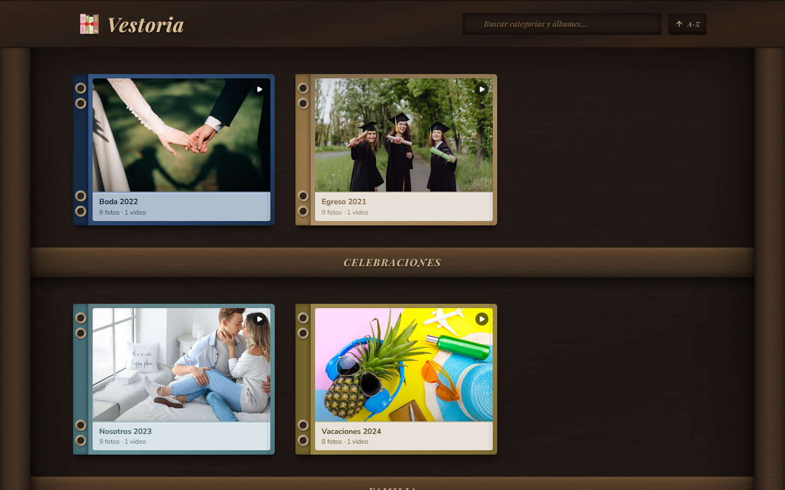
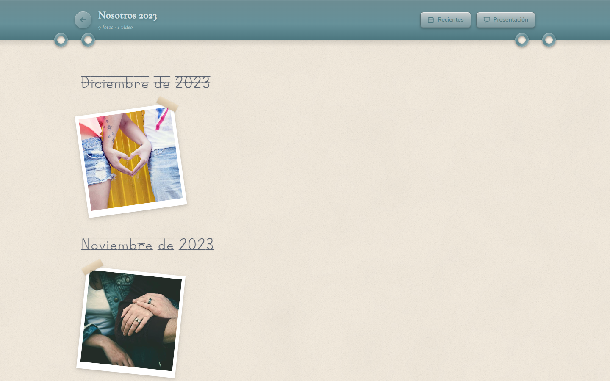
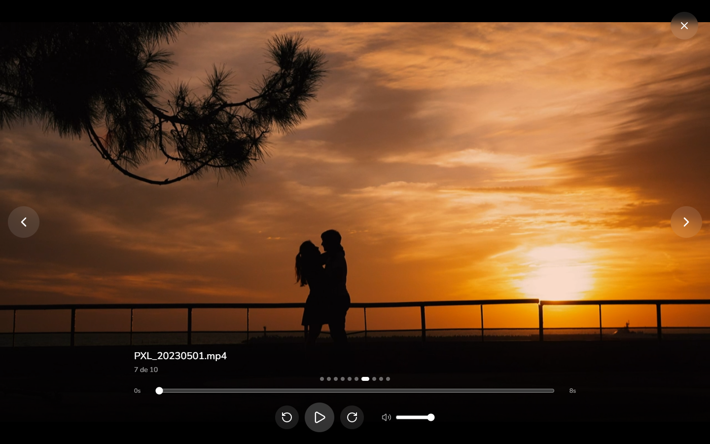
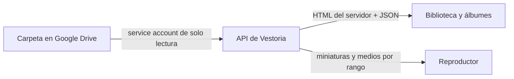

# Vestoria

**Una biblioteca digital para los recuerdos que eliges conservar.**

Vestoria convierte una carpeta de fotos y videos organizada por álbumes en una
estantería que se recorre con pocos clics: cada álbum con su portada, sus
recuerdos ordenados por fecha y un reproductor propio que funciona igual en la
computadora, el celular o la televisión. Está pensada para personas mayores y
familias que quieren ver y mostrar sus fotos sin aprender otro sistema.

[](https://github.com/AgusMS7/vestoria-biblioteca-digital/actions/workflows/ci.yml)
[](./LICENSE)

**[Ver la demo](https://vestoria-demo.vercel.app)** · **Contáctame:** [agustin.matias.sandoval@gmail.com](mailto:agustin.matias.sandoval@gmail.com)

`Next.js 16` · `React 19` · `TypeScript` · `Google Drive API` · `Vercel`



<sub>La demo es pública, no pide login y usa fotos y videos de stock.</sub>

## Por qué Vestoria

Las fotos importantes merecen algo más que una lista de archivos. Vestoria parte
de algo que muchas personas ya hacen: ordenar fotos en álbumes y guardarlos en un
estante. La app lleva esa costumbre a la pantalla y no pide nada a cambio: no hay
cuentas que crear, aplicaciones que instalar ni panel que aprender.

Detrás de cada decisión hay una misma pregunta: *¿qué necesita alguien que solo
quiere ver y mostrar sus recuerdos?* De esa pregunta salen tres principios:

| Principio | Cómo se traduce |
|---|---|
| **Fricción mínima** | Se abre y ya está la biblioteca. Pocos controles, álbumes grandes, letras grandes y solo los filtros necesarios. |
| **Familiaridad antes que novedad** | Estantes, álbumes encuadernados y fotos tipo polaroid: una metáfora que se reconoce sin explicación. |
| **Simplicidad que se mantiene sola** | Sin base de datos ni servidor propio que administrar. Quien usa la app organiza su biblioteca con carpetas, como ya lo hace. |

## Qué hace

- **Biblioteca por estantes.** Cada categoría es un estante de madera y cada
  álbum, una tarjeta encuadernada con anillas y su portada. Cada álbum conserva
  siempre el mismo color, elegido entre 16 paletas.
- **Orden por fecha automático.** Dentro de cada álbum, las fotos y los videos se
  agrupan por mes y año, en orden ascendente o descendente. Lo que no tiene fecha
  queda al final, sin estorbar.
- **Reproductor propio.** Pantalla completa con zoom, rotación, navegación con
  teclado o deslizando el dedo y presentación automática: las fotos pasan cada
  6 segundos y los videos se reproducen hasta el final. Los videos se pueden
  adelantar sin esperar a que se descarguen completos.
- **Lo justo para encontrar.** Búsqueda por nombre de categoría o álbum y orden
  alfabético con un botón. Cada álbum indica cuántas fotos y cuántos videos tiene.
- **En cualquier pantalla.** Probada en computadora, celular y televisión.
- **Cada deploy con su nombre.** El encabezado muestra la marca que se configure
  para cada instalación; el código es el mismo.

## Recorrido

| Biblioteca | Álbum | Visor de foto | Visor de video |
|---|---|---|---|
|  |  |  |  |

Para recorrerla de punta a punta: **[vestoria-demo.vercel.app](https://vestoria-demo.vercel.app)**.

## Diseño: el calor de un hogar

Vestoria no se parece a un panel de administración, y es a propósito. Se diseñó
para alguien a quien le gusta sentarse a ordenar sus álbumes de fotos: el
objetivo era que la pantalla se sintiera como un hogar y no como un sistema más
de los que se usan todo el día.

Por eso el estilo es **rústico y clásico**, no minimalista: madera oscura con
vetas, papel cálido, fotos tipo polaroid con cinta y una animación de un libro
mientras carga. La accesibilidad forma parte del mismo diseño: tipografías
grandes y claras, álbumes grandes y fáciles de abrir, y una interfaz que se
entiende de un vistazo, también en la pantalla de una televisión.

Las texturas no son imágenes: la madera y el papel se dibujan con gradientes CSS
y filtros SVG (`feTurbulence`). Así la estética no le cuesta tiempo de carga a
quien abre la biblioteca.

## Cómo se integra y se consume

Vestoria lee una carpeta de **Google Drive** y la presenta tal como está
organizada. No hay que subir los archivos a otro lugar ni cargarlos en un panel:
la estructura de carpetas **es** la biblioteca.

```text
Mi biblioteca/                 ← carpeta raíz
├── Familia/                   ← categoría (un estante)
│   ├── Vacaciones 2024/       ← álbum
│   │   ├── cover.jpg          ← portada (opcional)
│   │   ├── IMG_20240112.jpg
│   │   └── PXL_20240112.mp4
│   └── Nosotros 2023/
└── Viajes/
    └── Bariloche 2022/
```

- **Categoría** = carpeta de primer nivel. **Álbum** = subcarpeta.
- **Portada** = un archivo `cover.jpg` (también `.jpeg`, `.png` o `.webp`); si no
  hay, se usa la primera foto.
- **Fecha** = se toma del nombre del archivo; si no tiene, de los metadatos EXIF
  de la foto; y si tampoco, de la fecha de modificación. El nombre va primero
  porque es lo único que controla quien arma la biblioteca: basta con renombrar
  una foto como `IMG_20180520.jpg` para ubicarla en mayo de 2018, digan lo que
  digan sus metadatos.

Por dentro, la app solo lee:



Ningún archivo se sirve con un enlace público de Drive: todo pasa por la API de
Vestoria, que decide el formato, la caché y el tramo de video que se entrega. El
mismo código sirve a distintos deploys, cada uno con su carpeta, sus credenciales
y su nombre en el encabezado; hoy funciona en la demo pública y en un deploy
privado para un cliente.

Detalle completo en [docs/architecture.md](./docs/architecture.md).

## Stack

| Capa | Tecnología | Para qué |
|---|---|---|
| Framework | Next.js 16 (App Router, React Compiler) | Render en servidor y API en un solo proyecto |
| UI | React 19 + Tailwind CSS 4 | Componentes y estilos, incluidas las texturas |
| Lenguaje | TypeScript (strict) | Modelos tipados de categorías, álbumes y medios |
| Animación | Framer Motion + Lottie | Transiciones del reproductor y animación de carga |
| Datos | Google Drive API v3 | Única fuente de datos, en modo lectura |
| Imágenes | sharp | Miniaturas y conversión de HEIC a JPEG |
| Calidad | Vitest + ESLint + GitHub Actions | Tests, lint y build en cada cambio |
| Deploy | Vercel | Un proyecto por deploy sobre el mismo repositorio |

Versiones exactas en [docs/architecture.md](./docs/architecture.md).

## Decisiones técnicas

**Carga**

- La biblioteca se arma en el servidor y llega completa en el primer render: no
  hay pantalla vacía mientras cargan los datos.
- Álbumes y portadas se piden en paralelo, con un máximo de 4 consultas a la vez
  para no saturar Drive.
- Los listados siguen la paginación de Drive hasta el final: un álbum grande no
  se corta.
- El catálogo se cachea en la CDN (`s-maxage` + `stale-while-revalidate`); los
  errores nunca se cachean.
- La librería de animación (Framer Motion) queda fuera del código inicial de la
  biblioteca.

**Multimedia** — [docs/media-pipeline.md](./docs/media-pipeline.md)

- Miniaturas en tres tamaños: primero la que ya generó Drive y, si no existe, una
  propia con `sharp`.
- Los videos responden a pedidos por rango (`206 Partial Content`): arrancan y se
  adelantan pidiendo a Drive solo el tramo necesario.
- Las fotos HEIC/HEIF de iPhone se convierten a JPEG para que se vean en
  cualquier navegador.

**Fechas** — [docs/date-ordering.md](./docs/date-ordering.md)

- Prioridad nombre → EXIF → fecha de modificación, con validación de patrones
  para no confundir un identificador con un año.
- El EXIF se lee solo cuando el nombre no trae fecha, descargando los primeros
  64 KB del archivo, con caché y un tope de lecturas por request.

**Robustez sin fricción** — [docs/configuration.md](./docs/configuration.md)

- Límite de 300 requests por minuto por IP en la API, IDs validados antes de
  consultar Drive y solo imágenes y videos permitidos.
- Los errores internos quedan en el servidor; el navegador recibe mensajes
  genéricos.
- La configuración se lee al usarse: el build no necesita credenciales y, si
  faltan, la API responde `503` con un aviso claro.

## Números y evidencia

| Dato | Valor |
|---|---|
| Demo pública | 3 categorías · 6 álbumes · 54 medios (48 fotos y 6 videos) |
| Tests automatizados | 49 tests en 10 archivos, en verde |
| Integración continua | lint + build + tests en GitHub Actions, en verde |
| Respuestas de la API | `200` · `206` · `400` · `404` · `415` · `416` · `429` · `503` |
| Pantallas probadas | computadora, celular y televisión |

## Límites conocidos

Cada límite es el costo de una decisión tomada a favor de la simplicidad:

- **La carpeta es el modelo de datos.** No hay base de datos que mantener; a
  cambio, hay menos control: la búsqueda es por nombre de categoría o álbum, y la
  escala depende de la API de Drive.
- **Sin login por defecto.** Se prioriza que cualquiera de la familia pueda
  entrar sin claves. Para fotos privadas conviene una cuenta de Google dedicada
  solo a la biblioteca y una dirección que no se publique. Hay una contraseña
  opcional (Basic Auth) que se activa por configuración.
- **Videos de tamaño moderado.** La respuesta de medios se arma en memoria; en
  Vercel cada respuesta completa tiene un tope de 4,5 MB, por eso los videos de
  la demo pesan menos de 4 MB. Para videos grandes haría falta streaming real.
- **Caché en memoria por instancia.** En un entorno serverless acierta poco; la
  caché de la CDN cubre el catálogo.
- **No aparece en buscadores.** Todas las páginas envían `noindex, nofollow`: la
  biblioteca se comparte por enlace.

## Correrlo localmente

Requiere **Node.js 20.9 o superior** y una carpeta de Drive compartida en modo
lector con un service account de Google Cloud que tenga la Drive API habilitada.
El paso a paso está en [docs/configuration.md](./docs/configuration.md).

```bash
git clone https://github.com/AgusMS7/vestoria-biblioteca-digital.git
cd vestoria-biblioteca-digital
npm ci
cp .env.example .env.local   # completar los valores; nunca versionarlos
npm run dev                  # http://localhost:3000
```

| Variable | Obligatoria | Para qué |
|---|---|---|
| `GOOGLE_PROJECT_ID` | Sí | Proyecto de Google Cloud |
| `GOOGLE_CLIENT_EMAIL` | Sí | Email del service account |
| `GOOGLE_PRIVATE_KEY` | Sí | Clave privada del service account (con `\n` literales) |
| `GOOGLE_ROOT_FOLDER_ID` | Sí | Carpeta raíz de la biblioteca |
| `SITE_NAME` | No | Nombre del encabezado (por defecto, `Vestoria`) |
| `SITE_AUTH_USER` / `SITE_AUTH_PASS` | No | Contraseña opcional; se activa solo si están las dos |
| `ALLOW_EMBED` | No | Permite mostrar el sitio dentro de un iframe; se aplica en el build |

Para comprobar que todo está conectado: `GET /api/categories` responde `200` con
las categorías, o `503` si faltan credenciales. Si algo no aparece, revisa
[docs/troubleshooting.md](./docs/troubleshooting.md).

```bash
npm test         # Vitest
npm run lint     # ESLint
npm run build    # build de producción
```

## Documentación

| Documento | Qué cubre |
|---|---|
| [docs/architecture.md](./docs/architecture.md) | Capas, flujo de datos, API y decisiones estructurales |
| [docs/media-pipeline.md](./docs/media-pipeline.md) | Formatos, miniaturas, rangos de video, HEIC y límites |
| [docs/date-ordering.md](./docs/date-ordering.md) | Cómo se decide la fecha de cada foto y cómo se agrupa |
| [docs/configuration.md](./docs/configuration.md) | Variables, permisos de la carpeta y opciones por deploy |
| [docs/troubleshooting.md](./docs/troubleshooting.md) | Síntomas frecuentes, causas y cómo verificarlos |

## Autor y licencia

Diseño, desarrollo, integración y despliegue: **Agustín Sandoval**.

El código se distribuye bajo licencia [MIT](./LICENSE). Las fotos y los videos de
la demo son material de stock con sus propias licencias y no forman parte del
código.

El contenido, la marca y los datos del cliente no están cubiertos por la
licencia MIT. Ver [NOTICE.md](./NOTICE.md).

¿Quieres una biblioteca así para tu familia, o conversar sobre el proyecto?

**Contáctame:** [agustin.matias.sandoval@gmail.com](mailto:agustin.matias.sandoval@gmail.com)
