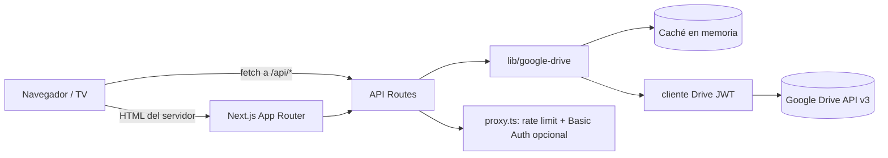

# Arquitectura

## 1. Propósito y alcance

Vestoria es una aplicación web de **solo lectura** que presenta álbumes de fotos
y videos almacenados en Google Drive como una biblioteca ordenada. No posee base
de datos, no escribe en Drive y no tiene panel de administración: la estructura
de carpetas del usuario es el modelo de datos.

Este documento describe las capas, los módulos, el flujo de una request típica y
el contrato superficial de las API Routes. El detalle de multimedia vive en
[`media-pipeline.md`](./media-pipeline.md), el de fechas en
[`date-ordering.md`](./date-ordering.md) y el de variables en
[`configuration.md`](./configuration.md).

## 2. Stack verificado

Fuente: `package.json` y `package-lock.json` (lockfile v3). Extraído el
2026-11-20.

| Capa | Tecnología | Versión instalada |
|---|---|---|
| Runtime | Node.js | `>=20.9` (`engines` en `package.json:5-7`) |
| Framework | Next.js, App Router, `reactCompiler: true` | `16.2.7` |
| UI | React / React DOM | `19.2.4` |
| Lenguaje | TypeScript (strict) | `5.9.3` |
| Estilos | Tailwind CSS 4 (`@tailwindcss/postcss`, tema en `globals.css` con `@theme inline`) | `4.3.0` |
| Animación | `framer-motion`, `lottie-web` (`public/book-loading.json`) | `12.40.0`, `5.13.0` |
| Iconos / utilidades | `lucide-react`, `clsx`, `tailwind-merge` | `1.17.0`, `2.1.1`, `3.6.0` |
| Integración | `googleapis` (Drive v3, JWT service account, scope `drive.readonly`) | `173.0.0` |
| Imágenes | `sharp` | `0.34.5` |
| Calidad | ESLint + `eslint-config-next`, Vitest | `9.39.4`, `16.2.7`, `3.2.7` |
| Base de datos | **Ninguna** | — |
| Deploy | Vercel (entorno Production) | — |

La dependencia `framer-motion` ya no se incluye en el bundle inicial de la home
(fue movida fuera de esa ruta en la fase 1), pero sigue usándose en el visor y en
las transiciones del álbum.

## 3. Forma general



La integración externa es **una sola**: Drive API v3 en modo lectura. No hay CDN
propia, analytics ni servicios de terceros. Las imágenes y los videos se sirven
por las propias API Routes, nunca mediante URLs públicas de Drive.

## 4. Capas

### Presentación

- `src/app/page.tsx` — home. Es **Server Component** (`dynamic = 'force-dynamic'`):
  resuelve categorías y álbumes en el servidor y se los pasa como props a
  `LibraryClient`. Así evita mostrar el estado vacío antes de que lleguen datos.
- `src/components/library/LibraryClient.tsx` — cliente de la home. Mantiene
  búsqueda y orden; dibuja los estantes (`WoodShelf`) y las tarjetas.
- `src/app/album/[id]/page.tsx` — página de álbum. Es cliente: recibe el álbum,
  agrupa medios por mes/año y maneja la grilla de polaroids.
- `src/components/viewer/FullscreenViewer.tsx` — visor a pantalla completa:
  navegación, swipe, zoom, rotación, presentación automática y controles de video.
- `src/components/layout/*` — Header (búsqueda, orden, marca por deploy), Footer
  (marca fija `Vestoria`, autor y licencia), `SiteNameContext`.
- `src/components/ui/*` — `TextureFilters` (ruido SVG) y `LoadingOverlay`
  (animación Lottie).

La estética es parte de la arquitectura: la madera y el papel se simulan con
gradientes CSS y filtros SVG (`feTurbulence`), no con imágenes de textura. La
decisión se tomó por rendimiento.

### API Routes

Cinco rutas, todas `GET`, todas con `runtime = 'nodejs'`:

| Ruta | Parámetros | Respuesta principal |
|---|---|---|
| `/api/categories` | — | JSON `{success, data}` con las carpetas de primer nivel |
| `/api/categories/[id]/albums` | `id` de categoría | JSON con los álbumes de esa categoría |
| `/api/albums/[id]` | `id` de álbum | JSON con el álbum y sus medios |
| `/api/media/[id]` | `id` + header `Range` opcional | Binario, con soporte 206/416 |
| `/api/media/[id]/thumbnail` | `id` + query `size` | JPEG o 204 |

Formato JSON: `{success: true, data: ...}` o
`{success: false, error: "..."}`. Los errores reales nunca se exponen al
cliente; quedan en `console.error` del servidor.

### Servicios y dominio

- `src/lib/google-drive/client.ts` — singleton del cliente autenticado con JWT;
  scope `drive.readonly`.
- `src/lib/google-drive/service.ts` — `getCategories`, `getAlbums`, `getAlbum` y
  resolución de portadas. Usa `listAllFiles` para seguir `nextPageToken`.
- `src/lib/google-drive/mapper.ts` — transforma `drive_v3.Schema$File` en los
  tipos internos; detecta `cover.*`, calcula color dominante y aplica la
  allowlist de MIME.
- `src/lib/google-drive/date-extractor.ts`, `exif.ts`, `exif-reader.ts` — fecha y
  su fallback. Ver [`date-ordering.md`](./date-ordering.md).
- `src/lib/google-drive/list.ts`, `errors.ts`, `validation.ts` — paginación,
  error tipado `DriveNotFoundError` y validación de IDs de Drive.
- `src/lib/http/` — `cache-control.ts`, `range.ts`, `rate-limit.ts`.
- `src/lib/utils/` — concurrencia acotada y helpers de conteo/fecha.

### Caché

`src/lib/cache/` implementa `MemoryCache<T>` con TTL:

| Instancia | Clave | TTL |
|---|---|---|
| `categoryCache` | `'all'` | 1 h |
| `albumCache` | `category_${id}` | 1 h |
| `exifDateCache` | `${fileId}:${modifiedTime ?? ''}` | 1 h |
| Caché de thumbnails | `${fileId}_${size}` | Sin TTL, tope de 100 entradas |

En serverless cada instancia tiene su propia memoria, así que el acierto entre
requests es bajo. Es una optimización local, no una capa de persistencia.

### Configuración y seguridad

- `src/config/env.ts` es el **único** módulo que lee `process.env`. Acceso lazy:
  el build funciona sin credenciales; las variables `GOOGLE_*` se validan al
  usarse y su ausencia produce 503 `CONFIG_MISSING`.
- `src/proxy.ts` aplica rate limiting (300 tokens / 60 s por IP) antes del Basic
  Auth opcional, y solo en rutas `/api/*`.
- `next.config.ts` emite los headers de seguridad. Con `ALLOW_EMBED=true`
  sustituye `X-Frame-Options: DENY` por
  `Content-Security-Policy: frame-ancestors *`. Se resuelve en build.

## 5. Modelo de datos

No hay tablas ni migraciones. El árbol de Drive define la estructura:

```
GOOGLE_ROOT_FOLDER_ID/
└── Categoría/            → Category
    └── Álbum/            → Album
        ├── cover.jpg     → portada opcional
        ├── IMG_20240312_143000.jpg
        └── PXL_20240312_150000.mp4
```

Tipos internos (`src/types/`):

| Tipo | Campos |
|---|---|
| `Category` | `id`, `name` |
| `Album` | `id`, `title`, `year` (`number \| null`), `category`, `coverImage`, `description?`, `mediaCount`, `photoCount`, `videoCount`, `hasVideo`, `media[]`, `dominantColor {h,s,l}` |
| `Media` | `id`, `type` (`image` \| `video`), `fileName`, `title?`, `date?`, `year?`, `month?`, `width`, `height`, `duration?`, `thumbnailUrl`, `mediaUrl` |

`width`/`height` caen a `1920×1080` cuando Drive no informa metadata. `title` de
`Media` es igual a `fileName`.

## 6. Estructura de carpetas relevante

```
src/
├── app/
│   ├── page.tsx                    # Home (RSC)
│   ├── album/[id]/page.tsx         # Grilla del álbum
│   ├── api/                        # 5 routes documentadas arriba
│   ├── globals.css                 # tokens, madera, papel, animaciones
│   ├── layout.tsx                  # metadata, fuentes, SiteNameProvider, Footer
│   └── robots.ts
├── components/                     # layout / library / ui / viewer
├── config/env.ts
├── lib/
│   ├── cache/                      # MemoryCache + singletons
│   ├── google-drive/               # cliente, servicio, mapper, fechas, errores
│   ├── http/                       # cache-control, range, rate-limit
│   └── utils/                      # concurrencia y helpers
├── types/
└── proxy.ts                        # rate limit + Basic Auth
```

## 7. Flujo típico: abrir la home

1. El navegador pide `/`. `page.tsx` (RSC) llama a `getCategories()`.
2. `getCategories` consulta `categoryCache`; si no hay entrada, lista carpetas de
   primer nivel con `listAllFiles` (que sigue `nextPageToken`).
3. Para cada categoría se llama a `getAlbums` con concurrencia acotada a 4.
4. Cada álbum resuelve su portada (`cover.*` o primera imagen) y sus conteos.
5. `LibraryClient` recibe todo como props: no hay `fetch` adicional para pintar
   el estado inicial. La búsqueda y el orden ocurren en el cliente.
6. Las miniaturas se piden lazy a `/api/media/[id]/thumbnail?size=large`.

## 8. Flujo típico: reproducir un video

1. La página del álbum solicita `/api/media/[id]` con `Range` del reproductor.
2. La ruta valida el ID y el MIME contra la allowlist.
3. `parseRangeHeader` calcula el tramo; la respuesta es `206` con `Content-Range`,
   o `416` si el rango es inválido.
4. Drive recibe el mismo `Range` y devuelve solo ese tramo.
5. El visor precarga el medio anterior y el siguiente.

Ver [`media-pipeline.md`](./media-pipeline.md).

## 9. Decisiones estructurales

| Decisión | Motivo | Coste asumido |
|---|---|---|
| Drive como único storage | Sin mantenimiento de backend; el usuario gestiona sus fotos | Menos control y escalabilidad |
| Sin base de datos | La carpeta ya existe y es entendible por cualquier persona | Sin índice propio ni búsqueda server-side |
| Home en RSC | Evita el empty state antes de cargar | Complejidad en el límite servidor/cliente |
| Concurrencia acotada (4) | Evitar cascadas de requests a Drive | Latencia algo mayor que con paralelismo libre |
| Texturas simuladas con CSS | Rendimiento de carga | Menos realismo que las texturas originales |
| Rate limit en proxy | Proteger las API Routes sin tocar cada handler | Estado en memoria por instancia |

## 10. Referencias

- [`media-pipeline.md`](./media-pipeline.md)
- [`date-ordering.md`](./date-ordering.md)
- [`configuration.md`](./configuration.md)
- [`troubleshooting.md`](./troubleshooting.md)
- Ficha técnica del workspace: `_portfolio/projects/vestoria-biblioteca-digital.md` §2–§4.
